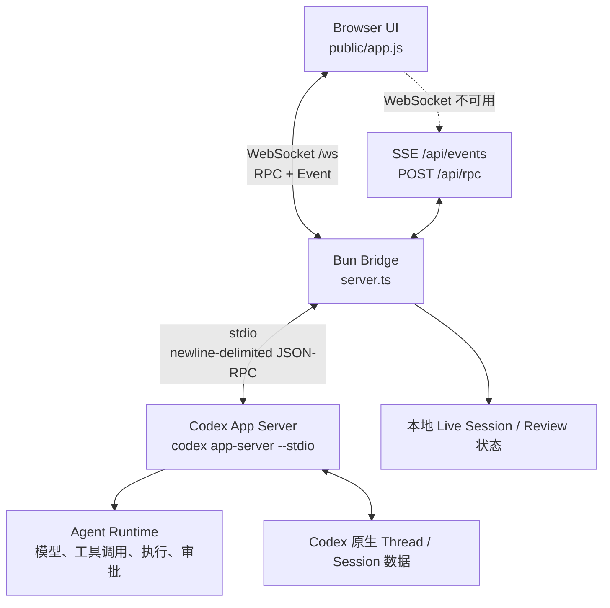
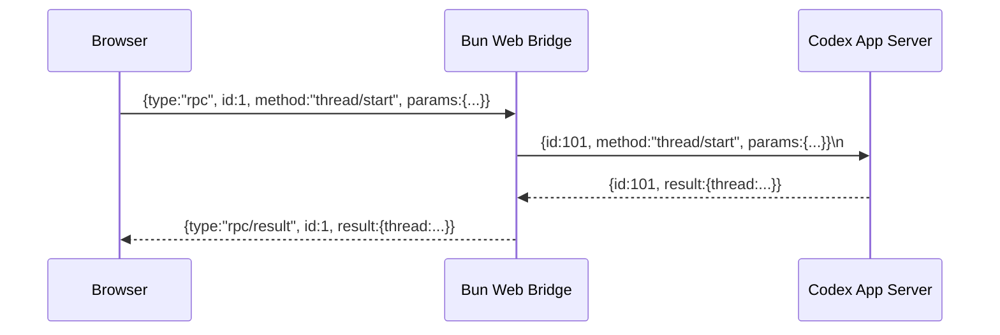
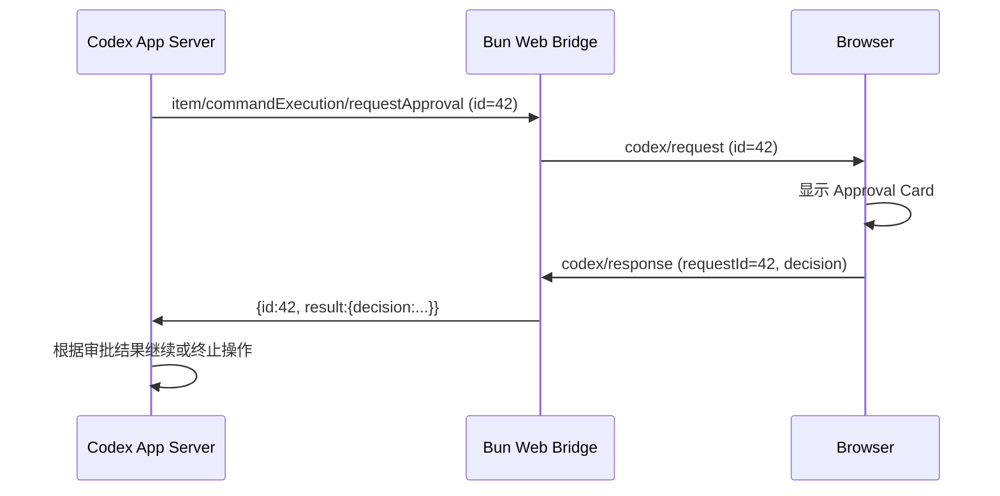
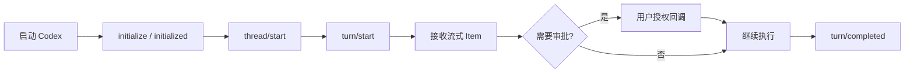

# Codex App Server WebUI 接入架构与实现

> 参考项目：[lezi-fun/codex-webui](https://github.com/lezi-fun/codex-webui)（main 分支，2026-10-16 检视）。本文聚焦 **Codex 接入**，不展开 WebUI 视觉设计。该项目为非官方实现。

## 1. 架构概述

Codex WebUI 不解析交互式 `codex` 终端输出，也不自行实现 Agent 核心逻辑。它将 **Codex CLI 的 `app-server --stdio` 模式**作为后端 Agent Runtime，通过 Bun 服务在浏览器与 Codex 之间完成双向 JSON-RPC 桥接。



**设计原则**：WebUI 负责协议桥接和展示；Agent 的 Thread/Turn/Item 状态及工具执行以 App Server 为权威数据源。

## 2. 关键源码

| 文件 | 作用 |
| --- | --- |
| [`server.ts`](https://github.com/lezi-fun/codex-webui/blob/main/server.ts) | 启动 Codex 子进程，双向 JSON-RPC，WebSocket/SSE 桥接，通知广播，审批回传 |
| [`public/app.js`](https://github.com/lezi-fun/codex-webui/blob/main/public/app.js) | 浏览器 RPC，Thread/Turn 操作，实时事件处理，审批 UI |
| [`server-security.js`](https://github.com/lezi-fun/codex-webui/blob/main/server-security.js) | 浏览器可调用 RPC 方法白名单、认证等 |
| [`live-session-service.js`](https://github.com/lezi-fun/codex-webui/blob/main/live-session-service.js) | 辅助读取、整理正在进行的 Session 数据 |
| [`review-state.js`](https://github.com/lezi-fun/codex-webui/blob/main/review-state.js) | 保存和组织 Review 状态 |
| [`review-service.js`](https://github.com/lezi-fun/codex-webui/blob/main/review-service.js) | 受限 Git Undo / Reapply |

## 3. 启动 Codex App Server

`server.ts` 使用 `spawn` 建立常驻子进程：

```ts
const child = spawn("codex", ["app-server", "--stdio"], {
  cwd: defaultCwd,
  env: process.env,
  stdio: ["pipe", "pipe", "pipe"],
  detached: process.platform !== "win32",
});
```

- `stdin`：Web Bridge 向 App Server 发送请求、初始化消息及审批结果。
- `stdout`：App Server 输出以换行分隔的 JSON 消息；Bridge 缓冲、逐行解析。
- `stderr`：记录诊断日志，不当作业务事件流。
- 进程退出后：拒绝未完成的 RPC、通知前端断线、清理部分状态并安排重启。

初始化协议的源码示例：

```ts
const result = await request("initialize", {
  clientInfo: {
    name: "codex-webui",
    title: "Codex WebUI",
    version: "0.2.0",
  },
  capabilities: { experimentalApi: true },
});
sendRaw({ method: "initialized", params: {} });
```

这一步属于 App Server 协议初始化，不是用户创建 Thread。

## 4. 双向 JSON-RPC 机制

### 4.1 浏览器主动请求 Codex



前后两侧请求 ID 各自独立：WebUI 的浏览器请求 ID 由前端维护，Bridge 向 App Server 发送时另分配 ID，并使用 `pending` 映射关联 App Server 返回值。

服务端核心逻辑（简化示意）：

```ts
function request(method, params = {}) {
  const id = seq++;
  sendRaw({ id, method, params });
  return new Promise((resolve, reject) => {
    pending.set(id, { resolve, reject });
  });
}
```

实际源码还包含超时和错误处理，不能直接将该片段用于生产。

### 4.2 App Server 主动请求浏览器审批

App Server 不只返回响应，还会主动发送带 `id` 和 `method` 的 Server Request。Bridge 将其广播为 `codex/request`，用户选择批准或拒绝后，浏览器提交 `codex/response` 或 `codex/error`，Bridge 再将同一个 App Server `requestId` 回写至 `stdin`。



## 5. Thread、Turn 与消息数据模型

概念层级：

```text
Thread（对话/工作会话）
  └─ Turn（一次用户驱动的 Agent 执行）
       └─ Item（消息、推理摘要、命令执行、文件修改等）
```

常用 App Server 方法：

| 方法 | 用途 |
| --- | --- |
| `model/list` | 获取模型列表 |
| `thread/list` | 列出历史线程 |
| `thread/read` | 读取指定 Thread 及其 Turn |
| `thread/start` | 创建 Thread，设置工作目录与权限策略 |
| `thread/resume` | 恢复 Thread |
| `thread/delete` | 删除 Thread |
| `turn/start` | 在 Thread 中开始新的 Turn |
| `turn/steer` | 为正在运行的 Turn 补充指令 |
| `turn/interrupt` | 中断正在进行的 Turn |

`host/thread/live` 是该仓库在 Bridge 层提供的**本地扩展方法**，不是普通的 Codex App Server 原生方法；服务端将它转发至自有的 Session 读取逻辑。

### 5.1 发送一次新请求

`public/app.js` 的 `submitPrompt()` 核心路径：

1. 当前没有 Thread：调用 `thread/start`，保存返回的 Thread ID。
2. 若已有 Thread 需要恢复：调用 `thread/resume`。
3. 调用 `turn/start`，提交文本输入、模型、推理强度、工作目录和权限策略。
4. 前端先插入临时用户消息，随后用真实 App Server 事件更新状态。

`turn/start` 的典型调用结构（字段依据仓库当前实现）：

```js
await rpc("turn/start", {
  threadId: activeThread.id,
  input: [{ type: "text", text: prompt }],
  model: selectedModel,
  effort: selectedEffort,
  cwd: activeThread.cwd,
  // 其余由当前权限策略生成
});
```

在 Turn 正运行时，前端可尝试：

```js
await rpc("turn/steer", {
  threadId: activeThread.id,
  expectedTurnId: activeTurnId,
  input: [{ type: "text", text: "补充指令" }],
});
```

## 6. Streaming：从 App Server 通知到 WebUI

服务端解析来自 stdout 的 JSON 消息，按类型区分：

- **RPC Response**：根据 ID 完成 Pending 请求。
- **Server Request**：转为 `codex/request`，等待浏览器响应。
- **Notification**：转为 `codex/notification` 并广播。

主要 Notification：

| 事件 | 浏览器动作 |
| --- | --- |
| `thread/started` | 插入 Thread |
| `turn/started` | 记录正在运行的 Turn |
| `item/started` | 增加执行 Item |
| `item/agentMessage/delta` | 增量拼接和渲染回答 |
| `item/reasoning/summaryTextDelta` | 更新推理摘要 |
| `item/commandExecution/outputDelta` | 更新命令输出 |
| `item/fileChange/patchUpdated` | 更新文件修改状态 |
| `turn/diff/updated` | 更新 Review Diff |
| `thread/tokenUsage/updated` | 更新 Token 用量 |
| `turn/completed` | 标记 Turn 结束 |

浏览器的 `handle()` 分发消息，`onNotification()` 更新具体 Item/Turn 状态。主通道使用 `/ws` WebSocket；WebSocket 连接不可用时，前端回退到 `EventSource('/api/events')` 接收通知，并使用 `POST /api/rpc` 发送请求。

因此，**SSE 在该项目中是传输回退方案，不是 Agent 事件的原始生成端**。

## 7. 审批与 Diff Review

三个明确处理的审批事件：

```text
item/commandExecution/requestApproval
item/fileChange/requestApproval
item/permissions/requestApproval
```

前端根据请求构造 Approval Card，用户选择的决策由 `respondToCodex()` 回传。工具能否继续执行由 Codex App Server 决定。

Review 通过 `turn/diff/updated` 等通知获取变更；后端记录 Diff，`review-service.js` 在校验允许的仓库根路径后，通过 `git apply --reverse` / `git apply` 执行 Undo / Reapply。浏览器不应被允许上传任意 Diff 或指定任意执行目录。

## 8. Browser RPC 安全边界

`server-security.js` 中以 `BROWSER_RPC_METHODS` 白名单限制可被浏览器直接调用的 App Server 方法。当前列出的典型方法包括：

```text
model/list
permissionProfile/list
thread/list
thread/read
thread/delete
thread/resume
thread/turns/list
thread/start
turn/start
turn/steer
turn/interrupt
```

不要把浏览器 WebSocket 当作完全可信的 Codex App Server 客户端。生产部署需要进一步控制：

- 浏览器认证与授权；WebSocket 握手鉴权。
- Workspace 及文件路径限制；避免通过 RPC 绕过目录边界。
- Approval 所属会话与用户的校验，尤其是多浏览器并发访问时。
- 凭据只在服务端保存，不下发到浏览器。
- 外网部署必须增加 HTTPS、反向代理、安全审计和隔离策略。

## 9. 生命周期与局限

仓库当前使用 **一个 Bun Bridge 管理一个长期运行的 Codex App Server 子进程**，而不是每个浏览器连接创建一个独立 Agent 进程。若有多个浏览器客户端，它们通过同一个 Bridge 订阅广播事件。

当前机制包含：

- App Server 退出后重启和连接状态广播。
- Browser WebSocket/SSE 传输回退。
- Thread 列表刷新及历史读取，用来补偿部分状态。

但不能据此推断已具备生产级分布式 Session 恢复、持久化事件日志、并发审批仲裁和多租户隔离。若要支持团队共享服务，应引入独立的 Session Manager 和 Workspace Manager。

## 10. 接入实现最小路径

1. 安装、登录 Codex CLI，验证 `codex app-server --stdio` 可启动。
2. 通过子进程 stdin/stdout 实现换行 JSON-RPC 的解析、ID 映射、初始化握手、请求超时、重启。
3. 对外实现 `WebSocket /ws`：浏览器发送 RPC，Bridge 转发并返回结果。
4. 将 App Server 的 Notification 作为事件广播给浏览器。
5. 将 Server Request 路由到 Approval UI，并将用户决策回写 App Server。
6. 实现 `thread/list`、`thread/start`、`turn/start`、`thread/read` 和 `turn/interrupt`，完成基本闭环。
7. 增加 `turn/steer`、Diff Review、Token Usage、断线补偿和安全白名单。



## 11. 总结

Codex WebUI 接入的核心并不是重建 Agent，而是实现一个**有状态、支持双向请求的 App Server 协议适配层**：

- `stdio JSON-RPC` 连接 Codex Agent Runtime；
- `WebSocket`（及 `SSE + HTTP` 回退）连接浏览器；
- `Thread / Turn / Item` 作为状态模型；
- `Notification` 实现流式消息与工具活动；
- `Server Request / Response` 实现人机审批闭环；
- 白名单、工作区约束和凭据隔离保障最基本的安全边界。

这个仓库适合作为 **Codex App Server Web 客户端的参考实现**，若目标是远程多人系统，则要额外设计 Session 生命周期、多用户隔离和审批协调。

## 参考资料

- [仓库主页](https://github.com/lezi-fun/codex-webui)
- [README 中文版](https://github.com/lezi-fun/codex-webui/blob/main/README-zh.md)
- [server.ts](https://github.com/lezi-fun/codex-webui/blob/main/server.ts)
- [public/app.js](https://github.com/lezi-fun/codex-webui/blob/main/public/app.js)
- [server-security.js](https://github.com/lezi-fun/codex-webui/blob/main/server-security.js)
- [live-session-service.js](https://github.com/lezi-fun/codex-webui/blob/main/live-session-service.js)
