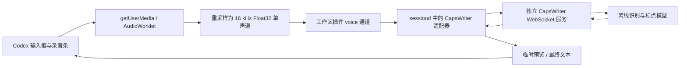

# Codex 编辑器离线语音输入支持计划

状态：仅保留文档，待重新实施。语音识别逻辑和独立后台服务代码已移除；麦克风按钮保留为禁用入口。本文只定义方案、开发步骤和验收标准，不代表功能已经接入。

技术核查日期：2026-10-17。已核对当前补丁、宿主通道限制和下文固定的上游源码；尚未安装模型或完成真实录音、Linux 部署验证。

目标：基于 [CapsWriter-Offline](https://github.com/HaujetZhao/CapsWriter-Offline) 的离线识别服务，为当前 pi-web Codex 输入框提供可用的语音转文字能力，录音界面采用用户提供的截图效果。

## 1. 当前情况与实施边界

当前仓库是补丁维护仓库，Codex 插件位于 [0006-codex-panel.patch](../patches/0006-codex-panel.patch)。补丁展开后的 `CodexPanel.ts` 只保留禁用的麦克风按钮；原浏览器 `SpeechRecognition` / `webkitSpeechRecognition` 调用、识别状态和回调已移除，独立离线服务及其安装脚本、依赖配置和测试也已移除。现状见 [Codex 插件使用说明](codex-usage.md#语音输入)，原后台方案见 [服务设计存档](voice-service.md)。

后续计划重新实现识别链路，并实现截图所示的录音状态。继续使用现有 `CodexBrowserRuntime.saveDraft()`、`send()` 和工作区插件接口，语音最终转换成普通文本输入。

首版范围：

- 点击麦克风开始；取消、停止并转写、停止转写后发送三条操作路径。
- 浏览器采集麦克风、显示真实音量波形，服务端使用本地模型识别中文及中英混合输入。
- 首页尚未创建会话时，以及已有会话内，均可使用；识别本身不创建 Codex 会话。
- 桌面端与移动端布局、异常提示、会话隔离、资源释放和部署说明。

后续范围：全局 CapsLock 快捷键、音视频文件转录、字幕、语音日记、LLM 润色、复杂热词管理。首版不引入 CapsWriter 桌面客户端的模拟按键、剪贴板写入和自动录音归档。

“离线”指识别模型无需外部云端语音服务；首次安装需准备依赖和模型。使用远程 pi-web 时，音频仍需传到选定的识别服务器；Codex 对话是否联网与语音识别无关。

## 2. 截图对应的输入效果

### 2.1 布局与视觉

录音状态直接放在现有圆角输入框内部，不增加弹窗。上方保留原草稿或占位提示，下方替换为录音控制条：

```text
╭─────────────────────────────────────────────────────╮
│ 原草稿 / Ask for follow-up changes                   │
│                                                     │
│  ( × )   · · · ▂ ▃ ▆ ▃ ▂ · · · · ·   ( ■ )   ( ↑ ) │
╰─────────────────────────────────────────────────────╯
   取消          真实音量点阵波形          停止      发送
```

- 沿用输入框圆角、边框和主题变量。深色主题呈现截图中的深灰底色、低对比度点阵和浅色发送按钮；浅色主题使用对应主题色。
- 左侧圆形 `×`；中部波形占满剩余空间；右侧深色圆形 `■` 与强调色圆形 `↑`。录音期间隐藏添加、权限、模型等常规工具，结束后恢复。
- 波形以等间距圆点为静音基线，声音增大时形成圆角短柱，平滑滚动；来自当前音频的 RMS/峰值，不使用随机动画模拟正在收音。
- 绘制使用 Canvas 或 SVG，音量刷新控制在约 30 fps，避免整块聊天面板随音频帧重渲染。按设备像素比适配清晰度。
- 桌面按钮视觉直径约 40–44 px，移动端点击区域至少 44 × 44 px；窄屏缩短波形，三个按钮不挤出输入框。
- 状态文字放在波形附近或输入框下方：准备麦克风、正在录音及计时、正在转写、失败原因。波形不承担唯一的状态提示职责。
- 三个按钮分别提供明确的可访问名称；状态区使用 `role="status"`，不逐帧播报音量。支持键盘焦点，减少动态效果设置下仍显示基本音量反馈。

### 2.2 三个按钮的语义

| 操作 | 行为 | 草稿与发送规则 |
| --- | --- | --- |
| 点击麦克风 | 检查服务与浏览器能力，申请权限，成功后进入录音条 | 保留已有草稿和文件引用 |
| `×` 取消 / Esc | 立即停止采集，取消本次转写，关闭音频通道 | 丢弃本次临时语音内容，保留开始录音前的草稿和引用；不发送 |
| `■` 停止 | 停止采集，发送最后音频帧，等待最终识别结果 | 完整结果追加到草稿，恢复普通输入框，可修改后发送；不自动发送 |
| 录音中的 `↑` 发送 | 明确记录本次发送意图，停止录音，等待最终结果 | 成功后合并原草稿与最终文字，再调用现有发送流程一次 |
| 转写中的 `×` | 取消等待并废弃迟到结果 | 清除发送意图，保留原草稿，不发送 |

发送按钮不能把尚未识别的音频直接提交给 Codex。无有效语音、识别失败、超时或上下文改变时，撤销本次发送意图，即使原草稿非空也不自动发送。转写成功但 Codex 发送失败时，保留合并后的文字和引用供重试。

录音和转写期间暂时锁定文本编辑、输入历史切换与文件引用修改，避免异步结果覆盖编辑；用户可先点停止，待转写后继续修改。此时 Enter 不发送，提交只通过明确的 `↑` 操作触发。转写中禁用停止和发送按钮，仅保留取消；连续点击不能重复结束或重复发送。

`■` 在录音条里只表示停止录音。Codex 已在生成或提交消息时，不允许启动录音，现有停止回答按钮保持原语义。

### 2.3 状态与会话隔离

主状态流：`idle → preparing → recording → finalizing → idle / sending`；任何活动状态均可进入取消或错误处理。

| 状态 | 界面 | 退出条件 |
| --- | --- | --- |
| `idle` | 普通输入框与麦克风入口 | 用户点击开始 |
| `preparing` | 准备提示，可取消；不显示已开始录音 | 麦克风、AudioContext 与后端通道均就绪 |
| `recording` | 截图中的取消、动态波形、停止、发送 | 停止、发送、取消、达到时长限制或异常 |
| `finalizing` | 静止波形/转写提示，仅取消可用 | 完整最终文本、超时或取消 |
| `sending` | 复用现有消息提交状态 | 后端确认后进入现有对话状态 |
| 错误 / 取消 | 释放资源，恢复普通输入框；错误保留可操作提示 | 可再次点击麦克风 |

每次录音分配新的 `recordingId` 和取消令牌，绑定 `machineId + projectId + workspaceId + threadId（允许为空）+ view generation`。切换机器、工作区、会话、返回首页或卸载面板时取消；迟到的权限授权、音频帧、识别结果和发送回调必须先校验绑定。

页面进入后台时首版采用取消策略，保留原草稿并提示录音已中断；普通焦点变化不取消。若权限弹窗尚未返回就被取消，后续取得的 `MediaStream` 立即停止，不再创建有效录音。所有退出路径停止 tracks、关闭 AudioContext、移除 worklet、取消绘制任务并关闭通道。

## 3. CapsWriter 技术依据

本计划核对的上游源码快照为 [`84912d5218ee5e51e216c54dc15a1cb0f466eb76`](https://github.com/HaujetZhao/CapsWriter-Offline/tree/84912d5218ee5e51e216c54dc15a1cb0f466eb76)。实施时固定通过验证的 commit、Python/依赖版本和模型文件校验值，不跟随浮动 master。

已确认的协议和限制：

| 项目 | 上游实际行为 | 本项目的接入决定 |
| --- | --- | --- |
| 服务 | WebSocket；配置默认监听 `0.0.0.0:6016` | 独立运行识别服务，部署时显式改为回环或受控内网地址 |
| 握手与消息 | 子协议名是 `binary`，实际音频消息是 JSON，其中 `data` 是 Base64 | 适配器按实际 JSON 协议发送，不能按名字理解成裸二进制协议 |
| 音频 | 16 kHz、单声道、Float32，每秒 64,000 字节 | 浏览器重采样并编码，不直接传 WebM/Opus/WAV 文件内容 |
| 请求字段 | `task_id`、`source`、`data`、`is_final`、`time_start`，以及分段、上下文和语言参数 | 由适配器生成并校验，不接受浏览器任意透传上游参数 |
| 结果 | `task_id`、`is_final`、`text`、时长和时间字段；另有字幕用途字段 | 使用 `text`，按当前任务校验；累计文本替换预览，最终只写入一次 |
| 流式能力 | 连续接收音频，按长度切段后识别 | 实时波形可立即反馈，不能承诺逐字实时出字 |
| 缓冲隔离 | `AudioCache` 按 WebSocket 连接保存 | 首版每次录音独占一个上游连接，不在同一连接交错多个任务 |
| 控制能力 | 已核对协议没有独立的取消、健康检查、结构化错误消息 | 取消通过关闭连接并丢弃结果；适配层补充状态和超时 |

依据：[协议](https://github.com/HaujetZhao/CapsWriter-Offline/blob/84912d5218ee5e51e216c54dc15a1cb0f466eb76/core/protocol.py)、[音频常量](https://github.com/HaujetZhao/CapsWriter-Offline/blob/84912d5218ee5e51e216c54dc15a1cb0f466eb76/core/constants.py)、[收音与切段](https://github.com/HaujetZhao/CapsWriter-Offline/blob/84912d5218ee5e51e216c54dc15a1cb0f466eb76/core/server/connection/ws_recv.py)、[WebSocket 服务](https://github.com/HaujetZhao/CapsWriter-Offline/blob/84912d5218ee5e51e216c54dc15a1cb0f466eb76/core/server/connection/server_manager.py)。

首版候选参数为 `seg_duration=15`、`seg_overlap=2`。上游非最终分段触发阈值为 `seg_duration + 2 × seg_overlap`，即约 19 秒；较短语音通常停止后才有文本。最终参数通过准确率和延迟测试确定，不把点阵动画误描述成识别进度。

模型优先验证 Paraformer CPU 路线，并准备其独立标点模型，作为 Linux 无界面部署的首版候选。上游当前配置默认选择 Qwen3-ASR，故必须显式设置模型，不能假设开箱就是 Paraformer。SenseVoice、Fun-ASR-Nano 和 Qwen3-ASR 的质量、内存、GPU 依赖另行测量，再决定是否开放选项。参考：[模型配置](https://github.com/HaujetZhao/CapsWriter-Offline/blob/84912d5218ee5e51e216c54dc15a1cb0f466eb76/config_server.py)。

热词与文字处理需要区分服务端和客户端：`hot-server.txt` 只在引擎声明支持热词时由服务端加载，不能承诺 Paraformer 拥有相同能力；`hot.txt`、`hot-rule.txt` 和 LLM 角色属于桌面客户端处理链，单接服务端不会自动获得。后续如需支持，应分别迁移和测试，尤其验证代码标识符、路径及英文术语不被误替换。依据：[模型加载器](https://github.com/HaujetZhao/CapsWriter-Offline/blob/84912d5218ee5e51e216c54dc15a1cb0f466eb76/core/server/worker/model_loader.py)、[客户端目录](https://github.com/HaujetZhao/CapsWriter-Offline/tree/84912d5218ee5e51e216c54dc15a1cb0f466eb76/core/client)。

## 4. 总体架构



浏览器复用 pi-web 同源连接及机器路由，由选定机器的 sessiond 连接配置的识别服务。浏览器不直接连接 `ws://localhost:6016`，避免把浏览器所在设备与工作区机器混淆，也避免 HTTPS 页面连接明文 WS 的问题。

Codex 现有 `events` 通道只推送会话变化通知，其 `receive()` 明确拒绝写入。因此新增独立 `voice` 双向通道，在 `server-plugin.ts` 中按 operation 路由；现有 `events` 通道继续由 `CodexService` 管理。语音服务与 Codex 子进程分开，识别前无需启动 `codex app-server`。

服务端通过宿主工作区能力校验调用上下文；上游地址只从服务端配置获取。每条音频通道绑定授权后的工作区和录音 ID，结果只回原通道，不广播给同工作区的其他标签页。部署验收必须验证现有鉴权实际生效，不能仅以配置了密码作为依据。

## 5. 音频采集与通道设计

### 5.1 浏览器采集

使用 `navigator.mediaDevices.getUserMedia({ audio: ... })` 取得音频，在用户点击事件中创建/恢复 AudioContext，以兼容移动端手势限制。HTTPS 或 localhost、麦克风授权、`AudioWorklet` 可用性均需检查；局域网普通 HTTP 不因改用离线模型而获得录音权限。参考：[getUserMedia](https://developer.mozilla.org/en-US/docs/Web/API/MediaDevices/getUserMedia)、[AudioWorklet](https://developer.mozilla.org/en-US/docs/Web/API/AudioWorklet)。

AudioWorklet 负责分块采样，主线程负责控制和绘制。不能依赖请求 `sampleRate: 16000` 就实际获得 16 kHz：读取实际采样率，对 44.1/48 kHz 等输入执行有抗混叠处理的连续重采样，并跨块保留滤波状态。单声道混音后以明确的小端 Float32 字节序传输，验证值有限且处于合法振幅范围。

首版不使用 `MediaRecorder` 容器转码路线，避免增加 FFmpeg 和浏览器编码兼容分支。Worklet 文件须作为插件静态资源打包，验证实际部署路径、MIME、CSP 和独立浏览器包加载。

### 5.2 新增插件协议（拟议，不是现有 API）

`peer.request("voice.status", {})` 返回启用情况、连通状态和服务端限制；不能只凭 WS 握手宣称模型健康。安装验收用已知音频完成真实转写，运行时展示最近成功/失败记录，识别异常由超时兜底。

`peer.openChannel("voice", { version: 1, recordingId, threadId }, ...)` 由宿主携带机器和工作区范围。拟议通道帧如下：

| 方向 | 类型 | 关键字段及规则 |
| --- | --- | --- |
| 服务端 → 浏览器 | `ready` | 协议版本、采样率、声道数、单帧/时长上限；上游连接就绪后返回 |
| 浏览器 → 服务端 | `audio` | `recordingId`、递增 `seq`、`samples`、`pcmBase64` |
| 服务端 → 浏览器 | `ack` | 已接受并转交上游的 `seq`；不代表已识别完成 |
| 浏览器 → 服务端 | `finish` | `recordingId`、最后 `seq`；所有尾部采样发送后只发一次 |
| 浏览器 → 服务端 | `cancel` | `recordingId`；与关闭通道一样触发清理 |
| 服务端 → 浏览器 | `partial` | 当前累计 `text`、单调递增的结果版本；只更新预览 |
| 服务端 → 浏览器 | `final` | 完整 `text`；同一录音最多应用一次 |
| 服务端 → 浏览器 | `error` | 稳定错误码及可展示消息；终止录音并撤销发送意图 |

适配器生成独立上游 `task_id`，把音频映射到 `source="mic"` 的 `AudioMessage`；统一保持 `time_start` 为 Unix 秒，`context` 首版为空，`language` 默认为 `auto`。确认全部音频按序发出后发送 `is_final=true`，可使用空尾包结束已有的非空音频；完全未采到音频时直接返回无有效语音。

上游普通音频消息示例（示例值仅说明结构，实际由适配器填写）：

```json
{
  "task_id": "server-generated-uuid",
  "source": "mic",
  "data": "<Base64 encoded Float32 PCM>",
  "is_final": false,
  "time_start": 1792195200.0,
  "seg_duration": 15.0,
  "seg_overlap": 2.0,
  "context": "",
  "language": "auto"
}
```

同一任务每帧保持 task_id、time_start 和分段参数一致。尾帧仍须带齐协议所需字段，仅将 `data` 设为空字符串、`is_final` 设为 true；发送后保持连接等待最终结果，不立即关闭。包装协议的 seq、samples 和 recordingId 由适配器处理，不直接透传为上游字段。[上游消息定义](https://github.com/HaujetZhao/CapsWriter-Offline/blob/84912d5218ee5e51e216c54dc15a1cb0f466eb76/core/protocol.py)。

上游 `text` 按累计结果处理，不逐条追加到草稿。只有最终结果才通过 `saveDraft()` 合并一次；录音开始时保存原草稿快照，取消和异常不写入临时文本。识别文字保持纯文本显示。

### 5.3 限额、背压与错误

当前 pi-web 基线 `36a359db276553b6e963e10ef31042a5c197c27c` 的 `src/shared/pluginBackendProtocol.ts` 将通道数据 JSON 限制为 64 KiB。首版音频按 100 ms 分块：1,600 个样本、6,400 字节原始数据、约 8.5 KB Base64；整个应用帧限制为 16 KiB，保留宿主封装空间，不提升宿主全局上限。

该基线还限制通道待处理队列为 128 帧 / 1 MiB，打开通道及单次回调的时限为 10 秒。`receive()` 只做校验和有界入队，上游发送与识别结果异步处理，不能在单次回调里等待整段推理完成。正常 finish 后保持通道到 final 发出并完成宿主发送排空，再结束；final 后的正常关闭不应显示为识别失败。依据：[宿主协议常量](https://github.com/jmfederico/pi-web/blob/36a359db276553b6e963e10ef31042a5c197c27c/src/shared/pluginBackendProtocol.ts)、[服务端通道接口](https://github.com/jmfederico/pi-web/blob/36a359db276553b6e963e10ef31042a5c197c27c/src/server-plugin-api.ts)。

拟议默认限制：

- 单次录音最长 120 秒（约 7.68 MB 原始音频）；达到上限自动停止转写并保留草稿，要求用户再点击发送。
- 每次录音最多积压约 2 秒音频，结合 ack 序号、宿主队列和上游 `bufferedAmount` 控制发送；超限终止并提示网络拥塞，不静默丢帧后继续输出不完整文字。
- 单页最多一个录音任务；共享识别实例首版限制一个活动任务，其他请求立即返回忙碌提示。多个 sessiond 共用模型时需统一准入，不能仅在各 sessiond 内分别计数。
- 连接超时暂定 5 秒，停止后最终结果超时暂定 30 秒；这些是待测默认值，不是性能保证。模型应预先启动加载，避免占用用户录音时间等待冷启动。
- 录音中连续 5 秒没有音频帧则中断任务并释放连接，避免页面异常挂起长期占用配额；静音时也应持续发送采样帧，因此该超时不等同于无语音检测。
- 严格检查序号、Base64、解码长度、Float32 对齐、累计时长和结果长度。无重传支持时发现重复或缺失序号就结束本次录音；断线后允许新开录音，不自动重放旧任务。

至少覆盖 `MIC_PERMISSION_DENIED`、`MIC_NOT_FOUND`、`INSECURE_CONTEXT`、`CAPTURE_UNSUPPORTED`、`ASR_UNAVAILABLE`、`ASR_BUSY`、`ASR_TIMEOUT`、`AUDIO_INVALID`、`QUEUE_OVERFLOW`、`NO_SPEECH`。上游目前没有完整结构化错误协议，适配器不能承诺精确区分所有模型内部故障。

关闭连接可停止接收结果，但不等于正在执行的模型计算立即中断。需验证上游的断连任务清理，忙碌配额不得在旧推理仍占资源时无限重复释放；必要时在受控的服务端适配版本中补充可观测任务状态。

## 6. 部署与配置

### 6.1 先通过 Linux 无界面验证

上游 README 只保证 Windows 10/11，未保证 Linux 兼容；依赖包含 `onnxruntime-directml`、桌面 UI 和 Windows 相关组件，`pyproject.toml` 还声明 Python ≥3.14。因此不能把 Windows 整包安装流程直接当作当前 Linux/WSL 服务部署步骤。依据：[平台说明](https://github.com/HaujetZhao/CapsWriter-Offline#-平台支持)、[服务端依赖](https://github.com/HaujetZhao/CapsWriter-Offline/blob/84912d5218ee5e51e216c54dc15a1cb0f466eb76/requirements-server.txt)、[项目依赖](https://github.com/HaujetZhao/CapsWriter-Offline/blob/84912d5218ee5e51e216c54dc15a1cb0f466eb76/pyproject.toml)。

阶段 A 必须验证：

1. 固定源码和 Python 版本，在隔离环境中整理实际服务端依赖，选择 Linux 可用的 CPU 推理包并锁定版本。
2. 显式设置 `enable_tray=False`、`gpu_boost_enabled=False`、`model_type="paraformer"`、回环监听地址，并检查启动路径是否仍导入 Windows 专用组件或等待交互输入。
3. 下载指定模型与标点文件，记录来源、大小、校验值；缺文件时清晰退出，不在生产启动时隐式下载。
4. 使用一段已知 16 kHz Float32 音频验证连接、切段、停止、最终文本、进程退出与重启，记录 CPU/内存/冷启动数据。

如果需要适配，优先保留上游识别及协议实现，增加最小的无界面入口或兼容补丁，并与固定 commit 一起维护。Linux 验证未通过前不承诺可用；可将受控 Windows 识别服务器作为备选，但需要明确其网络地址和运行依赖，不静默切换云端识别。

### 6.2 配置归属和进程生命周期

以下均为拟新增配置，当前脚本尚未支持：

```bash
# 拟写入 data/pi-web.conf，由运行脚本显式校验并导出给 sessiond。
PI_WEB_VOICE_PROVIDER=capswriter  # 可选 disabled；未配置默认 disabled
PI_WEB_CAPSWRITER_URL=ws://127.0.0.1:6016
PI_WEB_VOICE_MAX_SECONDS=120
PI_WEB_VOICE_FINAL_TIMEOUT_MS=30000
```

更新 `pi-web.conf.example`、运行脚本的配置读取/清理/导出逻辑及相关测试，遵循本项目“服务配置来自文件”的约定。不同机器分别配置其识别服务；界面显示可用性，不暴露内部地址编辑入口。

CapsWriter 首版由独立进程管理，模型只加载一次，多个工作区复用；不为每个 Codex thread 启动模型。pi-web 只管理自己的通道，不结束外部共享模型服务。部署交付需提供独立的服务端启动、停止、日志和健康验证步骤。

需要重启 pi-web 时严格使用本项目脚本，先停止再启动：

```bash
bash scripts/pi-web-run-jmfederico.sh stop
bash scripts/pi-web-run-jmfederico.sh start
```

上面是实施阶段的操作要求，编写本计划不执行重启。

### 6.3 数据与日志

音频仅在采集、传输和推理所需内存中短暂保留，完成、取消或超时后释放；首版不保存音频文件。关闭桌面客户端归档能力，并核对选定模型后端的临时文件行为。

上游 `ws_send.py` 会在 INFO 级别记录麦克风识别全文，默认配置日志级别为 DEBUG；`pipeline.py` 还直接向控制台打印拼接和格式化后的正文。因此仅做到 pi-web 不打印音频，或仅把上游日志级别降到 WARNING，均不足以阻止全部正文输出。部署适配须关闭或移除这些正文输出，并检查文件日志、标准输出及其进程管理器日志中均无音频 Base64、识别全文或草稿。依据：[上游结果发送和日志](https://github.com/HaujetZhao/CapsWriter-Offline/blob/84912d5218ee5e51e216c54dc15a1cb0f466eb76/core/server/connection/ws_send.py)、[推理流水线](https://github.com/HaujetZhao/CapsWriter-Offline/blob/84912d5218ee5e51e216c54dc15a1cb0f466eb76/core/server/worker/pipeline.py)、[日志实现](https://github.com/HaujetZhao/CapsWriter-Offline/blob/84912d5218ee5e51e216c54dc15a1cb0f466eb76/core/logger.py)。

运行日志只记录任务 ID、状态、耗时、数据大小、模型版本和错误码。原始 CapsWriter 端口不直接暴露公网；跨主机部署使用受控私网或加密隧道，鉴权在 pi-web 入口及适配层处理。上游监听配置为 `max_size=None`，且该连接入口未提供应用鉴权；不能把它当作可直接对浏览器开放的公共 API，大小限制必须在适配层落实。依据：[上游 WebSocket 监听](https://github.com/HaujetZhao/CapsWriter-Offline/blob/84912d5218ee5e51e216c54dc15a1cb0f466eb76/core/server/connection/server_manager.py)。

## 7. 代码改动与补丁交付

遵循 [补丁维护约定](usage.md#补丁分组)，在独立 release/维护目录中开发，最终将 Codex 功能归入现有 `0006` 补丁。不要直接修改正在运行的 release，也不要把临时版本堆叠为新的 Codex 补丁。

下列插件路径均为补丁展开后的路径；新文件名为建议：

| 文件或模块 | 计划变更 |
| --- | --- |
| `pi-web-plugins/codex/CodexPanel.ts` | 接通保留的麦克风按钮；实现截图录音条、按钮语义、预览和可访问状态 |
| `pi-web-plugins/codex/CodexBrowserRuntime.ts` | 接入 voice 通道、会话绑定、草稿合并与一次性发送意图 |
| `pi-web-plugins/codex/voice/VoiceController.ts` | 收音状态机、取消、超时、资源生命周期 |
| `pi-web-plugins/codex/voice/audio-worklet.ts` | 采样、持续重采样、音量统计与分块输出 |
| `pi-web-plugins/codex/voice/protocol.ts` | 帧类型、错误码、限制与校验 |
| `pi-web-plugins/codex/server/capsWriterService.ts` | 上游 WS 适配、独立录音连接、准入、结果转换、清理 |
| `pi-web-plugins/codex/server/server-plugin.ts` | 分流 `voice.status`、`voice` 与原有 Codex 请求/事件；卸载清理 |
| 插件构建脚本和 artifact 检查 | 确保 worklet 静态资源可被独立插件正确加载 |
| `scripts/pi-web-run-jmfederico.sh`、`pi-web.conf.example` | 语音配置读取、显式传递和诊断；维持先停后启行为 |
| `docs/codex-usage.md`、本文 | 完成后更新真实使用方式、安装步骤、验证记录和已知限制 |

识别服务源码、模型和虚拟环境放入忽略的 `data/` 或单独部署目录；仓库只保留版本清单、必要适配补丁和部署说明。引用上游代码时保留其 [MIT 许可及版权声明](https://github.com/HaujetZhao/CapsWriter-Offline/blob/84912d5218ee5e51e216c54dc15a1cb0f466eb76/LICENSE)，随模型和依赖分别记录其分发条件。

## 8. 实施阶段与完成标准

- [ ] **A：协议与部署验证。** 固定上游 commit，完成 Linux CPU 无界面服务和真实音频转写，明确依赖、模型、并发、日志及退出行为。交付可重复执行的部署步骤与测试记录；未通过则先解决兼容性。
- [ ] **B：截图交互。** 使用可控的音量和结果夹具完成录音条、状态机、取消/停止/发送、窄屏和浅深主题；模拟结果必须标明只用于开发验证。
- [ ] **C：真实采集。** 接入麦克风和 AudioWorklet，验证 44.1/48 kHz 转 16 kHz、静音、权限、移动端、尾部采样和释放。无需模型也能验证波形来源与音频正确性。
- [ ] **D：服务端接入。** 新增 voice 通道、CapsWriter 适配、工作区授权、限额与背压；跑通浏览器 → 本地模型 → 草稿闭环。
- [ ] **E：完整联调。** 验证截图交互、延迟、识别质量、会话隔离、断连和一次性发送；解决多 sessiond 共用服务的准入问题后再开放共享部署。
- [ ] **F：补丁与交付。** 更新 `0006`、配置与文档，从固定基线重新应用完整补丁链，运行相关测试与构建，记录已验证平台、浏览器和模型组合。

依赖顺序：A 先明确可部署后端；B、C 可在协议固定后开展；D 依赖 A 和 C；E、F 验证最终集成结果。首次可用版本以完整闭环为准，不能仅以波形出现或模拟转写成功宣布完成。

## 9. 验收清单

| 类别 | 必测场景 | 通过标准 |
| --- | --- | --- |
| 截图效果 | 深色/浅色、桌面、320–390 px 窄屏 | 取消—波形—停止—发送排列正确，按钮可点击，无横向溢出；波形随真实声音变化 |
| 三条操作路径 | 原草稿非空时取消、停止、直接点发送 | 分别保留原稿、合并后待编辑、识别完成后发送一次；停止不发送 |
| 权限与音频 | 拒绝/忽略权限、无设备、设备被占用、普通 HTTP、44.1/48 kHz | 明确提示，可重试；取消后迟到授权不继续收音；重采样后时长与音高正确 |
| 协议 | 超过分段阈值、尾包、累计文本、重复 final、坏 Base64、乱序帧 | 文本无重复、尾音不丢、非法帧拒绝，原草稿不损坏 |
| 隔离与生命周期 | 首页、切会话/机器/工作区、卸载、页面后台、多标签页 | 结果只归属原录音，失效回调不写草稿、不发送，麦克风和通道及时释放 |
| 失败与恢复 | 服务未启动、模型失败、断网、队列满、超时、发送失败 | 不假成功、不自动重放；保留正确草稿，可重新开始 |
| 限额与并发 | 120 秒上限、连续点击、两客户端同时录音、取消后重开 | 达上限停止并待确认；一次提交；忙碌提示明确，内存与推理队列有界 |
| 隐私 | 检查浏览器请求、两端日志、临时目录 | 无云端 ASR 请求，无默认录音留存和识别全文日志 |
| 部署与回归 | 新环境、模型缺失、插件禁用、重启、干净基线应用 | 失败可诊断；普通文本聊天和 Terminal 可用；补丁可复现 |

自动化测试重点放在音频格式/重采样、状态转换、任务隔离、背压、重复结果和协议错误；使用假 CapsWriter 服务覆盖失败路径。真实麦克风、浏览器权限、移动端音频和模型质量必须有人工或真实浏览器验证，不能仅用 mock 代替。

识别质量使用固定的中文、中英混合、数字、技术词和带背景噪声语料，保存参考文本，记录 CER/WER 与典型错误。建议先准备不少于 30 条样本。延迟记录冷启动、首段、停止到最终文本的 p50/p95、CPU 和峰值内存；以目标机器、选定模型和 10 秒语音测量，暖机后停止到结果 p95 ≤3 秒作为初始优化目标，实测前不作为已达成承诺。

交付时运行 Codex 相关测试、类型检查、插件 artifact 检查、完整构建及补丁仓库测试；在新目录从 `patches/base-commit` 应用全部补丁验证，不以已运行版本上的手工改动代替补丁验证。

## 10. 回退与完成记录

语音识别是可选能力。配置为 `disabled` 后入口显示不可用原因或隐藏，普通草稿、发送、会话历史保持可用；不自动回退到可能联网的浏览器识别服务。

升级异常时切回已验证的 pi-web release 和配置，按照脚本先停止、再启动；外部 CapsWriter 服务独立处理，不删除模型、用户草稿或 Codex 历史。重新启用前检查工作区机器与识别服务地址是否匹配。

实施完成后在此补充：固定源码/模型版本、测试机器与浏览器、依赖锁定清单、质量与延迟实测、截图验收、补丁验证结果、尚未支持的场景。当前所有实施项均待完成。
